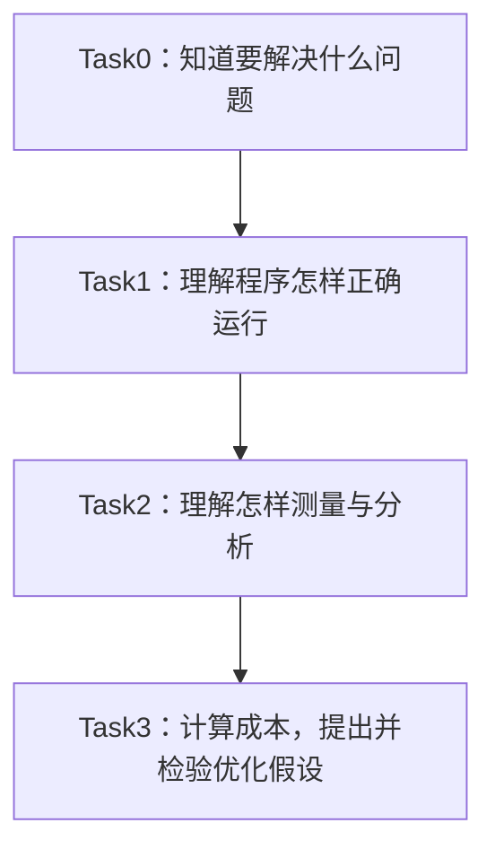

# 第一部分｜Task0、Task1、Task2 学习笔记与心得

## 范围与真实状态

这是依据 Datawhale Hello GPU 和本仓库已有记录整理的理论复习笔记。Task0暂作为“学习准备与路线”的整理名称；Task1沿用此前第0—4章、Task2沿用第5—7章的范围，Task0与Task1的导读内容存在交叉。它们不是已核实的官方活动任务划分。

笔记不代表个人已经完成设备实验。下面的心得是依据知识点拟写的表达稿，请按实际理解使用；没有编造安装成功、遇到报错、跑分或答题成绩。

## Task0：先知道学什么、为什么学

### 笔记

GPU学习不只是在框架里调用一个函数。模型运行慢时，还需要知道GPU实际执行了哪些计算、时间花在哪里、改动后结果是否正确。

三个词可以这样区分：

| 名称 | 通俗解释 | 例子 |
| --- | --- | --- |
| 算子 | 要完成的数学操作 | 两个数组对应位置相加 |
| Kernel | 在GPU执行的计算程序 | 通过线程索引处理数组的HIP函数 |
| Benchmark | 在明确条件下测量性能 | 重复运行后记录耗时分布 |
| Profiling | 观察执行过程，为分析原因提供证据 | 查看内核时间线和调用记录 |

算子与Kernel不是永远一一对应：一个算子可能分成多个Kernel，也可能将多个操作融合到一个Kernel。

学习路线是：理解执行和数据组织 → 测准时间 → 找到可能的瓶颈 → 修改实现 → 校验并复测。Agent可以组织这套流程，但自动生成的代码与结论也要接受同样的检查。

### 学习心得稿（50字以内）

优化前先弄清任务和测量方法。会调用函数只是起点，能用证据解释快慢，才是后续学习的重点。

### 真实反馈与下一步

当前能核对的是上述概念来源于教程。个人是否已经掌握，需要用自己的话解释“算子、Kernel、Benchmark、Profiling”的区别；本页没有代填掌握情况。

## Task1：环境、分工、数据和第一个程序

### 1. 环境要分层验证

环境检查分三层：系统与运行时能识别GPU、框架能在GPU完成计算、最小HIP程序能编译运行且结果正确。前一层成功不代表后一层必然成功。

记录设备型号和软件版本是为了让实验可复查。教程中的设备与历史速度不等于自己的设备和速度。

### 2. 线程分工靠索引

在一维、一线程处理一个元素的示例里：

```text
下标 = 块号 × 每块线程数 + 块内线程号
```

线程组成线程块，线程块组成网格。软件中的线程数量不等于硬件计算单元数量，也不代表所有线程在同一瞬间运行。

手算：N=10，每块4个线程，需要3块，共12个线程。下标0—9有效，10和11必须跳过数组读写。判断范围要放在读取之前。

### 3. 数据放在哪里，会影响访问方式

| 存储概念 | 怎样理解 | 不能混淆的地方 |
| --- | --- | --- |
| 寄存器 | 通常保存线程正在使用的局部值 | 资源有限，使用过多可能带来代价 |
| 全局内存 | 输入输出数组常用的设备存储空间 | 访问成本不能忽略 |
| 缓存 | 硬件帮助复用近期访问的数据 | 不等于程序显式管理的共享存储 |
| LDS／共享存储 | 线程块内协作时可显式使用的存储 | 需要正确的访问和同步安排 |

相邻执行通道访问相邻地址通常有利于成组访存，但速度还取决于对齐、访问模式和设备。独立向量加法没有线程间中间结果交接，不必强加LDS或屏障。

### 4. 发出任务不等于算完

CPU提交GPU任务后可能继续执行。测量函数调用前后的CPU时间，若未正确等待GPU完成，不能直接当成GPU计算耗时。

最小程序需要完成：准备数据 → 安排执行 → 等待必要工作完成 → 对照参考检查结果。除了普通长度，还要覆盖尾部不足一块的情况；只看程序不报错不够。

### 学习心得稿（50字以内）

线程索引决定谁处理数据，边界检查保证读写安全。环境能识别GPU后，还要验证计算结果是否正确。

### 真实反馈与下一步

已有笔记记录了环境、线程和数据的理论理解；本次没有新增设备运行日志。待实际操作后记录：设备____；框架计算结果____；HIP校验结果____；日志位置____。

## Task2：计时、Trace与性能判断

### 1. 先定义测量范围

端到端时间回答“用户总共等多久”；算子计时回答“数据准备好后，这段执行用了多久”。二者都可以测量，但不能混着比较。

Event在GPU时间线上记录标记。两个Event之间的间隔可能包含任务提交不及时造成的空隙，不能天然当作纯Kernel执行时长。

### 2. 让比较公平

先准备数据并检查结果，再预热、重复采样和记录统计值。比较前后版本时固定设备、输入、数据类型及计时范围；同时记录预热次数、采样次数和后台负载等条件。

中位数帮助了解典型样本，最小值只代表最快样本，批量总时间除以次数又是另一种统计方式。不要用一种版本的最小值和另一种版本的中位数来证明优劣。

### 3. Trace说明发生了什么

Trace可以帮助查看内核名称、开始结束时间与调用次数。分析目标内核时，需要区分预热、正式测量、辅助计算及校验相关记录。

看到时间差是观察；说“差异由缓存造成”是解释。解释还需要针对性实验支持。开启采集本身也可能影响时间，报告应注明是否启用了Profiler。

### 4. 数据量、带宽、算术强度

FP32向量加法每个输出对应：读4字节、再读4字节、写4字节，共12字节逻辑流量，做1次浮点加法。

- 总计算量F=N，逻辑数据量Q=12N。
- 算术强度AI=F/Q=1/12 FLOP/Byte。
- 有效带宽=Q÷时间，先将毫秒换成秒。
- Q是算法口径，不能直接当作硬件实测显存流量。

Roofline用带宽和计算能力建立参考，帮助提出瓶颈假设。点位低于参考线，并不能直接断定原因；小任务可能主要受启动开销影响。

### 学习心得稿（50字以内）

测速要统一范围并重复采样。Trace记录现象，Roofline帮助提出假设，性能原因还需要实验验证。

### 真实反馈与下一步

当前没有个人Trace文件或Benchmark原始样本，不能报告实际带宽、加速比或瓶颈已确认。待补充：计时范围____；预热与采样次数____；正确性____；时间分布____；证据文件____。

## 三个Task串起来



## 来源

- [第0章：学习路线](https://github.com/datawhalechina/hello-gpu/blob/main/docs/part0-intro/chapter0/index.md)
- [教程总目录与第0篇介绍](https://github.com/datawhalechina/hello-gpu)
- [第5章：可信计时](https://github.com/datawhalechina/hello-gpu/blob/main/docs/part1-profiling/chapter5/index.md)
- [第6章：Trace分析](https://datawhalechina.github.io/hello-gpu/part1-profiling/chapter6/)
- [第7章：Roofline](https://github.com/datawhalechina/hello-gpu/blob/main/docs/part1-profiling/chapter7/index.md)

依据Datawhale教程通俗整理，按[CC BY-NC-SA 4.0](https://creativecommons.org/licenses/by-nc-sa/4.0/)使用。

[第二部分：成本与优化考核](../task3/02-cost-optimization-quiz.md) · [返回首页](../README.md)
