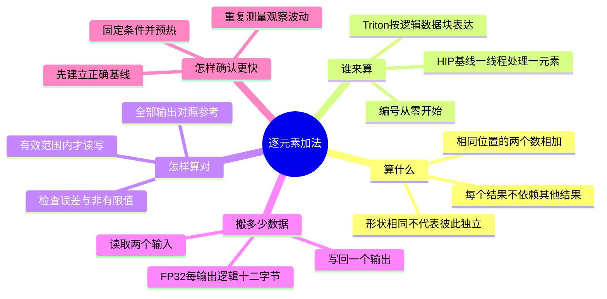
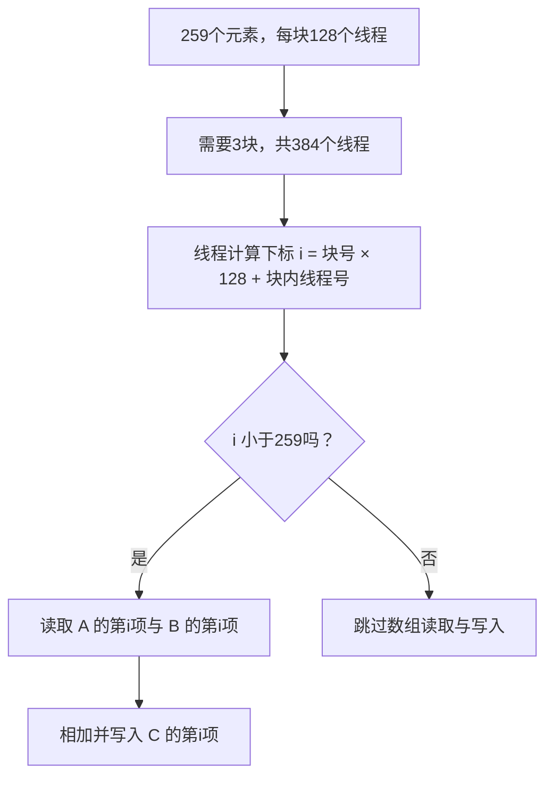
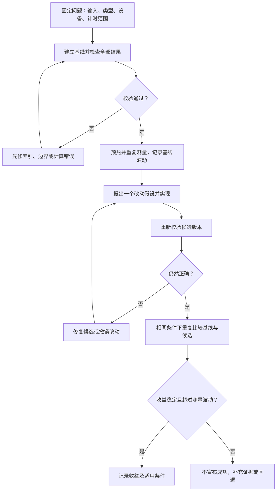

# Task3 第1天｜详细学习心得与考核

## 打卡摘要（43字）

逐元素加法让我理解了并行分工。先检查边界和结果，再比较速度，才不会把偶然变快当成优化。

## 本次学习范围

沿用本仓库已有安排，学习 Hello GPU 第8章的逐元素加法与正确基线。官方活动的 Task3 章节划分尚未核实。下文是辅助整理的学习笔记、手算练习与自测，不代表已经完成个人 GPU 实验。

## 一、把知识点说清楚

### 1. 为什么可以同时计算

逐元素加法就是把两个数组相同位置的数相加：

```text
A = [5, -2,  0, 7]
B = [4,  3, -6, 1]
C = [9,  1, -6, 8]
```

计算第三个结果，只需要 0 和 -6，不需要等前两个结果。这种“不同位置互不依赖”的特点，允许把工作交给不同线程并行处理。

这里最容易混淆的是：输入输出长度一样，不一定能独立计算。例如 Softmax 的每个输出还依赖整行数据。判断能否逐元素处理，要看需要哪些数据，而不是只看数组形状。

### 2. 线程怎样找到自己的工作

在一维、一线程处理一个元素的 HIP 基线中：

```text
全局下标 = 块号 × 每块线程数 + 块内线程号
```

编号从0开始。每块128个线程，块号2、块内线程号1，对应下标257。

若数组有259个元素，有效下标是0到258，需要3个线程块，共384个线程。最后一块只有3个有效位置，剩余125个线程必须跳过数组读写。

这像给259份作业安排384个座位：多出来的座位可以空着，不能让它们去取不存在的作业。

### 3. 边界检查必须保护读和写

```cpp
// 教学片段：一维 HIP 索引与边界逻辑，非完整可执行程序
int i = blockIdx.x * blockDim.x + threadIdx.x;
if (i < N) {
    C[i] = A[i] + B[i];
}
```

不能先读取 A[i] 和 B[i]，再只在写入时判断范围；读取时就可能已经越界。Triton 用 mask 保护逻辑位置时，也需要覆盖输入读取和输出写回。

HIP 从线程角度描述分工；Triton 通常从一个 Program 处理一组逻辑位置的角度描述。逻辑数据块不能直接当作物理线程或物理线程块。

### 4. 为什么要先算对，再谈快

“程序没报错”和“结果全部正确”是两回事。只检查第一个输出，也可能漏掉最后几个位置的错误。

校验时应确认形状和类型正确、有效输出都已写入、结果有限，并按约定误差与可靠参考逐个比较。测试长度至少覆盖很小的数组、恰好一块、比一块多一个及其他不整齐的长度。

简单独立加法不需要线程间交换中间结果，因此没有必要为了显得复杂而强加共享存储或同步屏障。

### 5. 加法少，不代表搬数据少

FP32 每个数占4字节。产生一个输出，要读取 A 和 B，再写入 C：

| 操作 | 每个输出对应的字节数 |
| --- | ---: |
| 读取 A[i] | 4 |
| 读取 B[i] | 4 |
| 写回 C[i] | 4 |
| 合计 | 12 |

因此 N 个元素对应逻辑流量12N字节、N次加法，算术强度是1/12 FLOP/Byte。这个口径不能直接当作硬件实际显存流量，因为缓存等因素会改变物理访问。

手算例子：100万个元素，假设计时0.25毫秒，逻辑流量1200万字节，有效带宽为48 GB/s。这是假设数据的演算，不是个人实测结果。

### 6. 怎样判断优化真的有效

基线是用于比较的正确版本。比较时保持输入规模、数据类型、设备和计时范围一致，先校验、预热，再重复测量并观察波动。

一次从0.20毫秒变成0.19毫秒，还不能说明优化成功。需要判断差异是否稳定，是否超过噪声，以及结果是否仍然正确。分配内存、生成数据、传输和校验是否计入时间，也必须说清楚。

## 二、思维导图

**读图顺序：先弄懂怎么算 → 分配位置 → 检查结果 → 算搬运成本 → 判断优化。** 为了避免一张图挤满小字，下面分成一张总图和两张重点图。例子均为教学手算。

### 2.1 总图：五个问题串起今天的知识



**用一个小例子理解第一条分支：** A=[5,-2]、B=[4,3]，输出是[9,1]。算出第二个结果1，不需要先知道第一个结果9。因此两个位置可以独立处理。Softmax则需要整行统计信息，不能仅凭形状相同认定独立。

### 2.2 重点图：线程怎样分工，尾部怎样保护

以下只讨论**一维、一线程一元素的HIP基线**。N是元素总数，B是每块线程数；所有编号从0开始。



| 线程块 | 对应下标 | 有效位置 | 应做什么 |
| --- | --- | ---: | --- |
| 块0 | 0—127 | 128个 | 逐个读取、相加、写回 |
| 块1 | 128—255 | 128个 | 逐个读取、相加、写回 |
| 块2 | 256—383 | 只有256、257、258，共3个 | 其余125个线程跳过读写 |

**记住这一点：判断范围必须发生在读取之前。** 只保护写回，仍可能发生越界读取。Triton也需要保护输入读取和输出写回，但它的逻辑位置数量不能直接理解成物理线程数量。

### 2.3 重点图：怎样把“看起来快”变成有证据的优化



**例子：** 一次测量从0.20毫秒变成0.19毫秒，只能说明这一次时间更短。要继续检查结果、重复测量、比较波动，才能判断改动是否有效。一次改动对应一个明确假设，更容易分析原因。

### 2.4 成本速记：一个加号背后有三份数据

| 要回答的问题 | 本例答案 | 容易误解的地方 |
| --- | --- | --- |
| 一个FP32数多大？ | 4字节 | 不是4位 |
| 每个输出搬多少？ | 两次读取加一次写回，共12字节逻辑流量 | 不能只数输出的4字节 |
| N个元素做多少次加法？ | N次 | 不等于只需要N字节 |
| 算术强度是多少？ | N÷12N=1/12 FLOP/Byte | N翻倍，比例不变 |
| 100万个元素是多少流量？ | 12,000,000字节 | 这是逻辑口径，不是实测物理显存流量 |
| 假设耗时0.25毫秒，带宽多少？ | 12,000,000÷0.00025=48 GB/s | 先将毫秒换成秒；数据不是个人实测 |

算术强度低，提示需要关注数据访问，但不能仅据此证明所有规模都只受显存带宽限制；小任务还可能受到启动开销影响。

### 2.5 看完导图，立刻检查是否理解

先遮住上面的例子，再尝试回答。下面的题号对应第四部分的完整考核。

| 导图分支 | 你应该能讲清的问题 | 对应考核 |
| --- | --- | --- |
| 算什么 | 为什么一个位置不用等另一个位置？ | 第1—2题 |
| 谁来算 | 块2中的线程1为什么负责下标257？ | 第3题 |
| 怎样算对 | 为什么尾部125个线程不能读写数组？ | 第4—6题 |
| 搬多少数据 | 为什么100万个元素要计1200万字节？ | 第7—9题 |
| 怎样确认更快 | 一次快了0.01毫秒，为什么证据还不够？ | 第10题 |

如果图暂时没有显示，直接按照这五行问题复习，含义与导图一致。

## 三、学习心得与感悟（详细版）

逐元素加法虽然只有一个加号，但真正需要理解的是“谁负责哪个位置”以及“哪些位置可以独立计算”。用小数组手算，比只记住并行这个词更容易看清数据之间的关系。

边界检查是本次笔记的重点。数组长度不一定刚好是线程块大小的整数倍，多出来的线程不能随意读写。保护输出还不够，输入读取也必须放在有效范围内。

性能分析也不能只盯着加法次数。每个结果背后还有两次读取和一次写回，因此要把搬数据的成本一起考虑。逻辑带宽帮助理解算法，但不能代替硬件实际访问证据。

后续练习应先证明结果可靠，再比较速度。把一次变快直接写成优化成功，容易忽略测量波动。能解释自己的索引、边界和测量条件，比单独记住一个速度数字更有价值。

## 四、考核行动：先答题，再核对

这是学习自测，不是课程官方评分。共10题，每题10分，总分100分。建议用15分钟独立作答；完成后再展开答案。答错的题用自己的话解释一次，再做同类题。

### 基础理解（每题10分）

**1. 为什么 C[i]=A[i]+B[i] 可以按位置并行？**

A. 每个位置只需要对应的两个输入  
B. GPU会自动消除所有数据依赖  
C. 所有形状相同的算子都能按位置独立计算  

**2. A=[5,-2,0,7]，B=[4,3,-6,1]，写出完整输出 C。**

**3. 每块128线程，块号2、块内线程号1，负责哪个下标？写出计算过程。**

### 边界与正确性（每题10分）

**4. N=259，每块128线程，一线程一元素：需要几块？最后一块几个位置有效？一共多少多余线程？**

**5. 先无条件读取 A[i]、B[i]，只有写 C[i] 时才判断 i<N，安全吗？怎样改？**

**6. 程序运行成功，第一个输出正确，能否认定整个数组正确？还需要检查什么？**

### 成本与性能（每题10分）

**7. 100万个FP32元素做独立加法，逻辑读写量是多少字节？说明组成。**

**8. 上题假设计时0.25毫秒，有效带宽是多少 GB/s？写出毫秒换成秒的过程。**

**9. 输入元素数量翻倍，算术强度是否翻倍？解释原因。**

**10. 某版本只测一次，从0.20毫秒变成0.19毫秒。能否宣布优化成功？写出至少两个后续检查。**

<details>
<summary>完成作答后，点击查看答案、解析与评分</summary>

1. **A，10分。** 每个结果只依赖对应位置的两个输入。
2. **[9,1,-6,8]。** 每个位置2.5分。
3. **2×128+1=257。** 公式5分，结果5分。
4. **3块；末块3个有效位置；125个多余线程。** 分别3、3、4分。
5. **不安全。** 判断不安全3分，指出读取已可能越界3分，将输入读取和输出写回一起放入有效范围判断内4分。
6. **不能。** 判断2分；提出全量对照参考、有限值与误差检查、有效输出完整写入、边界长度测试，每项2分。
7. **12,000,000字节。** 两输入各4,000,000字节、输出4,000,000字节，组成6分，合计4分。这是逻辑流量。
8. **48 GB/s。** 0.25毫秒=0.00025秒，4分；12,000,000÷0.00025÷10⁹=48，6分。
9. **不翻倍，仍为1/12 FLOP/Byte。** 结论4分，说明运算量和逻辑流量一起翻倍6分。
10. **不能。** 结论2分；以下任选两项，每项4分：重新校验全部结果；确认条件及计时范围一致；预热后重复测量并观察波动；用多组样本确认收益是否稳定。

自测建议：80分及以上可进入下一节；60—79分先重做错题；低于60分先复习索引、边界和计时口径。第5题答错时，无论总分多少，都应先补读写边界保护。以上阈值仅用于本页练习。

</details>

## 五、完成记录

以下项目留待真实执行后填写，不能把本页发布当作已通过考核：

- [ ] 独立完成10题，得分：____ / 100。
- [ ] 记录错题编号：____，用自己的话解释错误原因。
- [ ] 手算 N=257、每块128线程的分工，检查末块边界。
- [ ] 在可用GPU环境运行基线，保存设备信息、正确性检查与测量日志。
- [ ] 在相同条件下重复比较候选实现，记录是否有稳定收益。

**当前状态：** 理论材料与考核题已整理；个人答题得分和GPU实测结果待填写。

## 资料来源

- [Datawhale Hello GPU 第8章](https://datawhalechina.github.io/hello-gpu/part2-kernels/chapter8/)
- [教程源码](https://github.com/datawhalechina/hello-gpu/blob/main/docs/part2-kernels/chapter8/index.md)
- [HIP实现](https://github.com/datawhalechina/hello-gpu/blob/main/code/part2-kernels/chapter8/vector_add_hip.hip)

依据课程资料通俗改写，手算例子与考核题为辅助练习，按 [CC BY-NC-SA 4.0](https://creativecommons.org/licenses/by-nc-sa/4.0/) 使用。

[原有完整笔记与12道自测](day01-elementwise.md) · [返回 Task3 目录](README.md)
