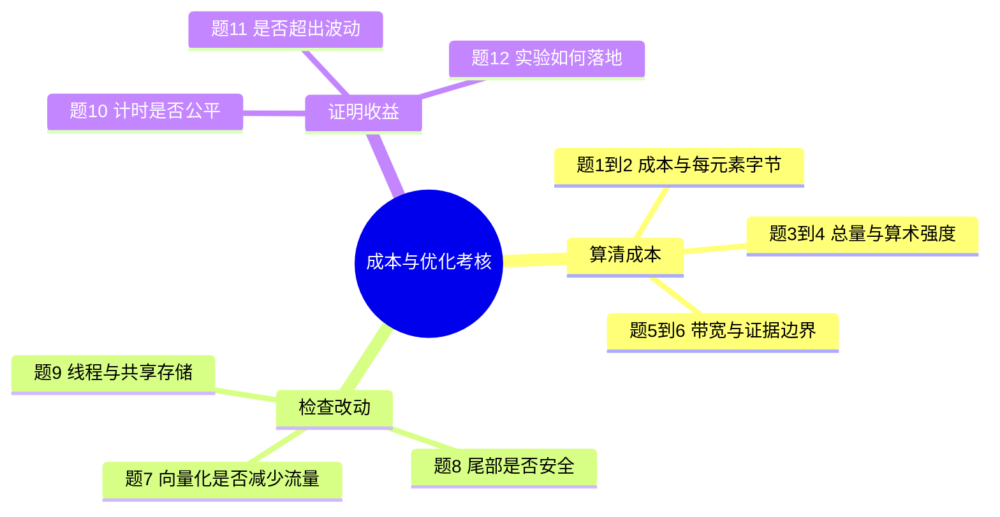

# 第二部分｜Task3 成本与优化：用题目学习

这里的“成本”指数据搬运量、计算量和执行时间。本页依据第7—8章整理，不是官方任务表或官方考试。题中数字均为教学条件；未运行个人GPU实验，也未给个人答题打分。

## 先看题目地图

## 作答区

建议先用自己的话回答，再展开解析。每题2分：结论正确1分，理由或计算过程正确1分，共24分。此规则仅用于自测，不是课程评分。

### 第1题｜成本到底指什么？

这页讨论的成本，是购买显卡的价格，还是运行计算时的数据搬运、运算和时间？请举出两项。

我的答案：________

答完再看解析

运行计算的资源与时间成本。本页重点是数据读写量、浮点运算量与耗时；不据此推算电费或云服务费用。

### 第2题｜为什么不是4字节？

FP32向量加法C[i]=A[i]+B[i]，每个数4字节。一个输出的逻辑读写量是多少？分别列出读取和写回。

我的答案：________

答完再看解析

读取A为4字节，读取B为4字节，写C为4字节，合计12字节。只计输出会漏掉两个输入。

### 第3题｜数组扩大后，工作量怎样变？

N=1,000,000时，逻辑流量和加法次数各是多少？N翻倍后呢？

我的答案：________

答完再看解析

原来是12,000,000字节与1,000,000次加法；翻倍后是24,000,000字节与2,000,000次加法。

### 第4题｜算术强度会翻倍吗？

用上一题计算F/Q。数组变大后，这个比例是否变化？

我的答案：________

答完再看解析

两种规模都等于1/12 FLOP/Byte，约0.0833。分子分母同时翻倍，比例不变。它表示每字节逻辑流量对应的计算量。

### 第5题｜有效带宽怎么计算？

假设100万个FP32元素相加耗时0.25毫秒。将毫秒换成秒，再算有效带宽。这里采用十进制GB。

我的答案：________

答完再看解析

0.25毫秒=0.00025秒。12,000,000÷0.00025=48,000,000,000 Byte/s，即48 GB/s。是假设数据手算，不是个人实测。

### 第6题｜有效带宽就是物理显存带宽吗？

上一题得到48 GB/s，能否断言显存总线实际传输了1200万字节？为什么？

我的答案：________

答完再看解析

不能。分子是算法逻辑流量，缓存命中与实际访问事务会影响物理传输。要讨论具体存储层级的流量，需要相应证据。

### 第7题｜改成float4就必然省四倍成本吗？

同样处理全部FP32元素，使用float4向量化访问后，逻辑流量是否自动变成原来的四分之一？速度是否必然四倍？

我的答案：________

答完再看解析

都不是。数学任务不变，仍需读取两个输入、写回输出；向量化可能改变指令与访问组织，但收益需要测量，还需检查对齐和尾部处理。

### 第8题｜怎样检查向量化的尾部？

每次处理4个元素，数组只有10个元素。能否直接把最后4个位置都当作有效数据？

我的答案：________

答完再看解析

不能。前两组覆盖0—7，剩余8、9两项需要安全处理；不能越界访问10、11。可设计标量尾部路径或其他正确的边界处理，然后验证所有输出。

### 第9题｜更多线程与共享存储一定更快吗？

有人建议把线程数调大，并给独立加法加入LDS和屏障。你是否直接接受？请说明检查方向。

我的答案：________

答完再看解析

不能直接接受。独立加法没有中间结果交换的需要；额外读写和同步可能增加成本。线程配置也涉及资源占用与调度，应每次检验一个明确设计假设。

### 第10题｜计时少一项，算优化吗？

原版耗时包括数据传输，新版只测Kernel。新版数字小了，能据此确认Kernel优化成功吗？

我的答案：________

答完再看解析

不能。计时范围不一致。应统一范围；若目标是端到端体验，就都包含相同的数据准备和传输阶段，若目标是算子执行，就用相同的算子测量口径。

### 第11题｜一次快了，证据够吗？

教学样本：基线三次为0.20、0.19、0.21毫秒；候选为0.19、0.21、0.20毫秒。能否只挑候选的0.19毫秒宣布更快？

我的答案：________

答完再看解析

不能。两组样本相同，只是顺序不同，中位数均为0.20毫秒。应报告完整统计并增加受控重复测量；这组样本不能支持候选更快。

### 第12题｜设计一轮真实优化实验

请按顺序写出：固定条件、基线校验、测量、改动、再次校验、比较及记录。没有GPU时可以完成哪些部分？

我的答案：________

答完再看解析

固定输入、类型、设备和计时范围；校验基线；预热并重复采样；提出一个假设并修改；重新校验；按相同条件复测并比较波动；记录保留或回退及依据。没有GPU可完成手算、代码逻辑检查和实验计划，不能填写虚构跑分。

## 真实反馈记录

| 项目 | 当前记录 |
| --- | --- |
| 材料与题目 | 已依据教程整理 |
| 个人答题 | 待作答，不能代填得分 |
| 正确性实验 | 未执行，待记录 |
| 时间、带宽、加速比 | 没有个人实测数据 |
| 错题与理解变化 | 待你作答后逐题反馈 |

完成后可以按“1：……；2：……”提交答案，我会逐题解释。若第8题或第10题错误，先补边界与公平计时，再继续优化练习。

## 学习心得稿（50字以内）

优化要先算清数据搬运成本，再验证改动是否安全、计时是否公平，最后用重复测量判断收益。

## 来源

- [第7章：成本、算术强度与Roofline](https://github.com/datawhalechina/hello-gpu/blob/main/docs/part1-profiling/chapter7/index.md)
- [第8章：逐元素算子优化](https://github.com/datawhalechina/hello-gpu/blob/main/docs/part2-kernels/chapter8/index.md)
- [第5章：可信计时](https://github.com/datawhalechina/hello-gpu/blob/main/docs/part1-profiling/chapter5/index.md)

依据Datawhale教程改写并自编题目，按[CC BY-NC-SA 4.0](https://creativecommons.org/licenses/by-nc-sa/4.0/)使用。

[第一部分：Task0—2笔记与心得](../notes/01-task0-task1-task2.md) · [Task3原打卡](01-reflection.md) · [返回首页](../README.md)
