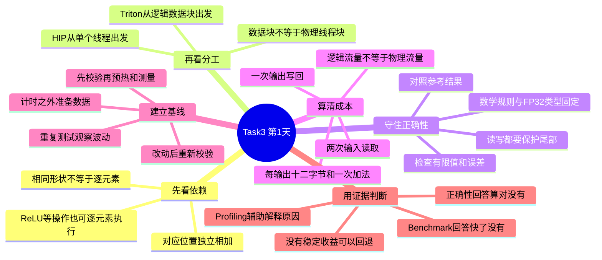

# Task3 · 第1天：从逐元素加法建立正确基线

日期：2026-10-24（北京时间）

> **范围说明：** 沿用此前按篇章整理的学习包，Task3暂对应第2篇“经典算子与Kernel实战”。今天先读第8章8.1—8.3及8.4的基线思路，不把这一安排称为已核实的活动任务表。
>
> 本页为辅助整理的理论笔记与教学自测。手算不等于设备实验，本文没有个人GPU实测时间或加速比。

## 1. 今天先理解哪件事

Task1关注“工作和数据怎样组织”；Task2关注“怎样量得可信”。今天把这两件事接起来：**先明确计算规则，做一个答案可靠的起点，再研究怎样修改。**

基线可以理解成“比较用的原版”。它需要可复现、结果正确、测试条件明确，不要求一开始就是最快的实现。候选代码更复杂，也不意味着更快。

## 2. 思维导图



如果设备未显示导图，可按“依赖 → 分工 → 正确性 → 成本 → 基线 → 证据”的顺序阅读下文。

## 3. 大白话讲解：同一排的两样东西配成一份

### 3.1 什么叫逐元素

把两排食材按位置配对：第一份用第一对，第二份用第二对；做第二份不需要等第一份的结果。这里用“配对”只解释数据依赖，不代表真实GPU硬件。

下面是本页自编的手算例子：

| 下标i | A[i] | B[i] | C[i]=A[i]+B[i] |
| --- | ---: | ---: | ---: |
| 0 | 5 | 4 | 9 |
| 1 | -2 | 3 | 1 |
| 2 | 0 | -6 | -6 |
| 3 | 7 | 1 | 8 |

因此输出为 `[9, 1, -6, 8]`。即使第3列先完成，其他列的数学答案也不会改变。

本章讨论的独立加法，每个输出只需要同位置的输入。ReLU把负数变成0，也可以独立处理；求总和则需要合并多个位置。**判断依据是依赖关系，不能只看输入输出形状。** 例如Softmax通常形状不变，但每个结果用到了整行的统计信息。

### 3.2 同一件事，可以用两种方式分工

| 路线 | 站在哪个角度写 | 今天要分清的边界 |
| --- | --- | --- |
| HIP | 一个线程计算自己的索引并处理元素 | 一个线程也可以通过循环处理多个元素 |
| Triton | 一个Program处理一组逻辑索引 | Program、逻辑Tile和物理线程块不能直接画等号 |

两条路线要完成同样的数学任务，采用一致的正确性标准。抽象方式不同，不意味着某条路线天然更快。

### 3.3 尾部不是“小问题”

对一维、一线程一元素的HIP基线，位置规则是：

```text
i = 块号 × 每块线程数 + 块内线程号
只有 i < N 时，才能读取两个输入并写入输出
```

用新例子手算：`N=259`，每块128个线程。

- 两块只能覆盖256个位置，仍剩3个，因此需要3块。
- 一共启动384个线程，有效下标为0—258。
- 第3块（块号2）的线程0、1、2处理下标256、257、258。
- 其余125个线程跳过数组读写，不能访问不存在的元素。

Triton的末块也可能只剩3个**逻辑位置**有效；使用mask标记这些位置，不能据此说“只有3个物理线程”。mask必须用于读取和写回两端，仅保护写回不能阻止错误读取。

### 3.4 校验应该查什么

只看到程序退出或只核对一个元素，都不足以说明整个数组正确。今天按下面的检查清单理解：

- 输入、输出形状和数据类型与目标一致。
- 每个有效位置都已写入，结果不是遗留的未初始化内容。
- 输出有限，排除NaN和无穷值。
- 对照可靠参考，按约定误差检查所有元素。
- 测试小长度、整块长度、比一块多1以及不能被4整除的长度。
- 正式计时前后都核对，修改映射后重新检查。

教程本章采用FP32参考，并约定有限性与绝对误差检查；不要把某个教学容差推广为所有算法的通用标准。有限个测试通过，也不等于证明所有输入都正确。

本例没有线程之间的中间结果交接，因此不需要为了“看起来优化了”而强行加入LDS或块内屏障。

## 4. 手算成本：为什么要关注搬数据

对本页的FP32独立向量加法，每输出要读取两个数、写一个数；每数4字节：

```text
逻辑数据量 Q = 3 × N × 4 = 12N Byte
运算次数   F = N FLOP
算术强度  AI = F / Q = 1/12 ≈ 0.0833 FLOP/Byte
```

这是算法口径。缓存、对齐和实际访问事务会影响物理流量，不能把12N说成硬件总线一定传输的字节数。

**自编教学测速数据，不是个人实测：**

假设N为1,000,000，Event间隔为0.25 ms：

```text
Q = 12,000,000 Byte
t = 0.00025 s
有效带宽 = Q/t/10^9 = 48 GB/s
计算吞吐 = F/t/10^9 = 4 GFLOPS
```

数组长度翻倍，F与Q一起翻倍，AI不变。48 GB/s和4 GFLOPS都由同一份假设计时换算，不能当作两份独立硬件证据。

低逻辑算术强度提示优先调查数据访问，但小任务也可能受启动等开销影响，不能直接宣布“已经证明只受显存带宽限制”。

## 5. 今天怎样理解“基线与优化”

| 环节 | 要回答的问题 | 不能误写成什么 |
| --- | --- | --- |
| 正确性检查 | 仍按相同规则给出可靠答案吗 | 程序能运行就一定正确 |
| Benchmark | 一致条件下，时间差异是否稳定 | 挑最快一次就证明更好 |
| Profiling | 有哪些记录支持或反驳原因假设 | 任意一个计数器就能解释全部变化 |

一轮实验可以这样组织：


数据分配、生成、H2D传输和校验应按本次目标放在计时区间之外；不能把不同计时边界的数字直接比较。Event间隔仍可能包含提交节奏带来的空隙，不天然等于纯Kernel时间。

后续的grid-stride、float4和Triton配置属于待检验的设计选择，不是按版本编号保证逐级加速。今天先把正确基线和公平比较弄明白。

**实际实验状态：** 本次完成的是资料整理、逻辑解释和手算核对；尚未在个人GPU执行本章程序。环境、正确性日志、样本统计及设备性能结果应在真实运行后补充。

## 6. 自测题：先作答，再展开答案

每题可自行对照判定是否理解；不将此自测分数当作课程官方成绩。

### 题1｜手算

上表的C[2]是多少？它需要先知道C[0]吗？

<details>
<summary>查看答案与解析</summary>

C[2]=0+(-6)=-6，不需要C[0]。本例的每列只依赖对应位置的两个输入。

</details>

### 题2｜判断

输入输出形状相同，就一定是逐元素算子。对吗？

<details>
<summary>查看答案与解析</summary>

不对。还要检查跨位置依赖。例如Softmax输出形状可与输入相同，但需要整行统计信息。

</details>

### 题3｜单选

HIP线程与Triton Program的关系，哪个说法合理？

A. 一个Program永远等于一个线程  
B. 逻辑Tile永远等于物理Block  
C. 二者是不同表达视角，不能按名字直接一一对应

<details>
<summary>查看答案与解析</summary>

选C。HIP基线描述单线程行为，Triton表达一组逻辑位置的运算；最终硬件映射由实现和执行配置决定。

</details>

### 题4｜索引

每块128线程，块号2、块内线程号1负责哪个下标？若N=259，能否访问？

<details>
<summary>查看答案与解析</summary>

2×128+1=257。因为257小于259，可以处理该元素。编号从0开始。

</details>

### 题5｜边界

N=259、每块128线程，需要几块？最后一块多少有效位置、多少多余线程？

<details>
<summary>查看答案与解析</summary>

需要3块。最后一块有3个有效位置，多余125个线程跳过数组读写。本答案限定一线程一元素的HIP分工。

</details>

### 题6｜找错误

先无条件读取A[i]、B[i]，只有写C[i]时才判断i<N，安全吗？

<details>
<summary>查看答案与解析</summary>

不安全。无效位置在写入前就可能已经被越界读取。HIP条件或Triton mask都需要保护读取和写回。

</details>

### 题7｜正确性

一个版本只检查第一个输出就通过，并且速度更快，能保留为正确优化吗？

<details>
<summary>查看答案与解析</summary>

证据不足。其他位置可能漏写、越界或出现非有限值。应先按既定标准全量核对，并覆盖尾部长度，再比较时间。

</details>

### 题8｜数据量

100万个FP32向量加法，为什么不是只计400万字节？

<details>
<summary>查看答案与解析</summary>

400万字节只是一份数组。两份输入读取加一份输出写回，逻辑合计1200万字节，不代表物理总线必然搬运相同字节。

</details>

### 题9｜单位换算

上述1200万字节、0.25 ms，算法有效带宽是多少？

<details>
<summary>查看答案与解析</summary>

0.25 ms=0.00025 s。12,000,000÷0.00025÷10^9=48 GB/s。此处是教学演算。

</details>

### 题10｜判断

N翻倍，FP32向量加法的AI会翻倍，而且一定更快。对吗？

<details>
<summary>查看答案与解析</summary>

两点都不能这样断言。AI仍为1/12；利用率和时间需要测量。更多元素意味着工作量也变大，不能凭规模预测耗时必然下降。

</details>

### 题11｜性能证据

某候选只测一次，从0.20 ms降到0.19 ms，是否已经证明改动有效？

<details>
<summary>查看答案与解析</summary>

没有。需要确认输出正确、条件一致，重复运行并观察分布或多个独立进程，判断差异是否超过波动。

</details>

### 题12｜设计选择

简单独立加法一定要加入LDS与块内屏障，才能充分利用GPU。对吗？

<details>
<summary>查看答案与解析</summary>

不对。本例没有线程间的中间结果交接，基线不需要它们。额外步骤可能产生开销，任何改动都要提出理由并验证。

</details>

## 7. 打卡心得（沿用此前50字以内格式）

**今天正文：**

理解了逐元素加法的独立性，先校验边界与结果，再建立公平基线，不能把一次变快当成优化成功。

**另外两条备选，不表示额外两天或重复提交：**

1. 学会区分线程与数据块，边界保护要覆盖读写；逻辑带宽不能当作物理显存流量。
2. 用手算理解加法的数据量和算术强度，优化前先明确正确性、计时范围与比较条件。

心得应按自己的实际理解修订。此页发布到GitHub不等于已提交飞书；课程要求的单Task提交规则仍按原通知执行。

## 8. 资料来源

- [Datawhale Hello GPU 第8章：Element-Wise](https://datawhalechina.github.io/hello-gpu/part2-kernels/chapter8/)
- [第8章教程源码](https://github.com/datawhalechina/hello-gpu/blob/main/docs/part2-kernels/chapter8/index.md)
- [HIP完整实现](https://github.com/datawhalechina/hello-gpu/blob/main/code/part2-kernels/chapter8/vector_add_hip.hip)
- [教程仓库](https://github.com/datawhalechina/hello-gpu)

本文依据第8章相关部分通俗改写，新增手算例子、自测题与心得；没有复制教程历史性能成绩作为个人成绩。原资料与改写按 [CC BY-NC-SA 4.0](https://creativecommons.org/licenses/by-nc-sa/4.0/) 使用。

[返回Task3目录](README.md) · [返回总目录](../README.md)
